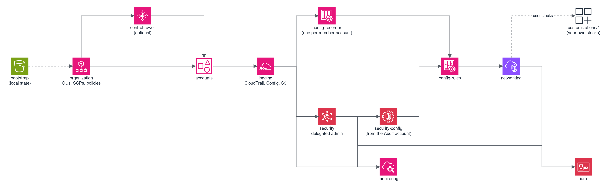

# Terraform Landing Zone

Terraform Landing Zone deploys and manages an AWS multi-account environment with native Terraform resources: organization, accounts, logging, security services, compliance rules and networking. Terragrunt orchestrates 21 modules with isolated state per module, dependency resolution and cross-account deployment.

> **This is sample code, for non-production usage. You should work with your security and legal teams to meet your organizational security, regulatory and compliance requirements before deployment.**

## Quick start

Prerequisites: Terraform >= 1.14, Terragrunt >= 1.0, and AWS CLI credentials for the management account.

```bash
# 1. Configure: copy the examples, then edit env/common.hcl
#    (region, profile, module toggles, accounts)
cp env/common.hcl.example env/common.hcl
cp env/accounts.hcl.example env/accounts.hcl

# 2. S3 backend only: in env/common.hcl set state_backend = "s3" and replace
#    the placeholder state_bucket_name and lock_table_name with real names,
#    then create them with the line below (remove its leading "# ").
#    With the default state_backend = "local", skip this step.
# (cd stacks/management/bootstrap && terragrunt apply)

# 3. Deploy (from the repository root; each subshell returns there)
(cd stacks && terragrunt run --all -- plan)     # Preview
(cd stacks && terragrunt run --all -- apply)    # Deploy
```

Offline checks: `make fmt`, `make validate`, `make lint`, `make scan`, `make test`.

What changed in each version: [CHANGELOG.md](CHANGELOG.md).

## Security considerations

The stacks run with management-account credentials and change the whole organization. Depending on the module toggles in `env/common.hcl`, an apply creates OUs, service control and resource control policies, an organization CloudTrail with a central log bucket, delegated administrators for the security services, IAM roles in member accounts and new AWS accounts; a wrong policy can lock users or pipelines out of member accounts, so read the plan before every apply. The deployment role is administrator-equivalent in every account it reaches; restrict who can assume it. State holds sensitive values: for a shared deployment use the S3 backend from the bootstrap stack and restrict access to its bucket. Accounts are not removed by a destroy (`close_on_deletion` defaults to `false`). The compliance configurations are a starting point, not an attestation.

## Cost

This sample creates billed resources in every account and region where they are enabled: GuardDuty, Security Hub, Detective and IAM Access Analyzer, the organization CloudTrail and its log storage, AWS Config recorders, rules and conformance packs, the Cost and Usage Report, and, when configured, Network Firewall, Transit Gateway and NAT gateways. Every account in the organization adds to the cost of the organization-wide services. Estimate your configuration with the [AWS Pricing Calculator](https://calculator.aws/) before the first apply, and use the budgets module to be alerted on spend. Log buckets keep their data after a deployment is removed; their storage is billed until the data expires or is deleted.

## Module dependencies



## Directory layout

- `docs/` - the guides: start with [docs/README.md](docs/README.md)
- `modules/` - the 21 Terraform modules, each with its own README and tests
- `stacks/` - the Terragrunt units that deploy the modules per account
- `configurations/` - the security baseline, compliance framework overlays and policy documents
- `customizations/` - a template and an example for your own Terraform modules
- `env/` - example configuration files
- `tests/` - Python regression tests of the modules, stacks and guard scripts

## License

This project is licensed under the MIT-0 License. See the [LICENSE](LICENSE) file.
