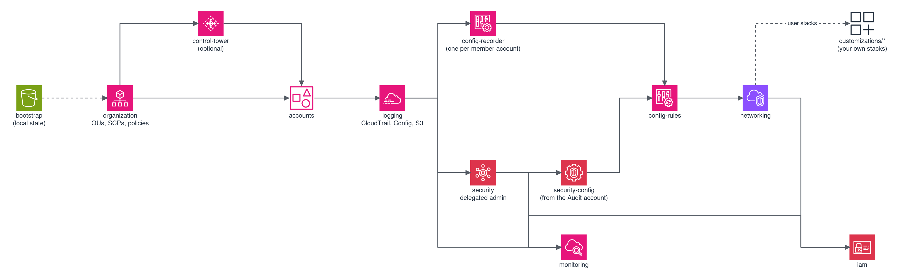
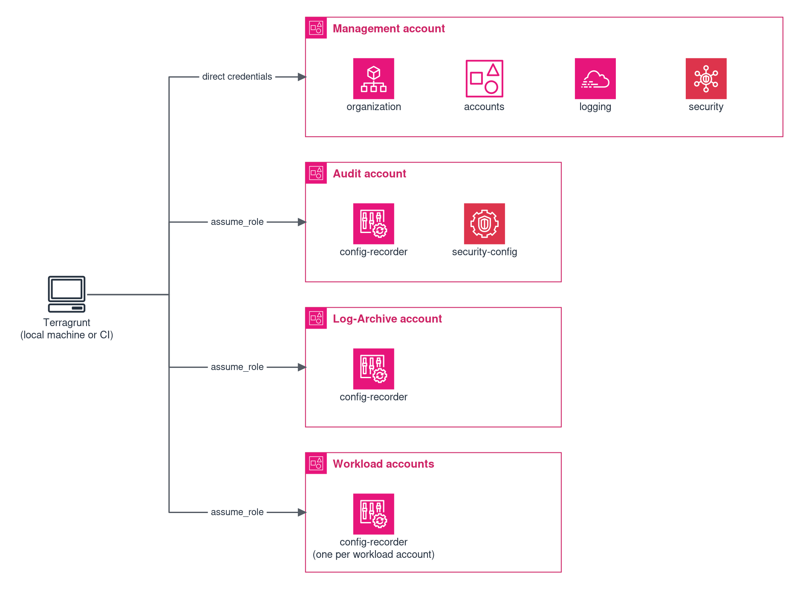

# Architecture

Developer reference for the Terraform Landing Zone — how modules work, how Terragrunt orchestrates them, and the design patterns used throughout.

## Design Principles

- Each module independently toggleable (`enable_<module> = true/false`)
- Terragrunt orchestrates execution order via dependency graph (DAG)
- One state file per module per account — error isolation, parallel execution
- Cross-account deployment via `assume_role` provider aliases
- No `local-exec`, no shell scripts, no external binaries in the deployment path
- Multi-partition (`aws`, `aws-eusc`) without code changes
- Every module that builds an ARN derives the partition from `data.aws_partition.current`

## Project Structure

```
terraform-landing-zone/
├── customizations/    ← User-created Terraform modules (extension pattern)
│   ├── _template/     ← Copy template for new modules
│   └── README.md      ← Conventions and how-to reference
├── modules/           ← Terraform modules (self-contained, reusable)
├── stacks/            ← Terragrunt orchestration layer
│   ├── root.hcl       ← Shared config (state, provider, retry)
│   ├── management/    ← Management account stacks
│   ├── audit/         ← Audit account (cross-account)
│   ├── log-archive/   ← Log-Archive account (cross-account)
│   ├── deployment/    ← Deployment account (optional)
│   └── workload-*/    ← Workload accounts (cross-account)
├── env/               ← common.hcl + accounts.hcl
├── configurations/    ← Security baseline + compliance framework configurations
├── tests/             ← Python property tests + HCL tests in modules/
└── docs/
```

## Dependency Graph



`iam` runs after `networking`: Managed Microsoft AD and the AD Connector are
placed in a VPC, and the VPC and subnet identifiers are outputs of the
networking stack. `config-rules` does not depend on `iam`: it reads no output
of `iam`, creates no IAM resource, and the two remediation identities it hands
out come from `env/common.hcl`, not from the iam stack (the full reasoning is
written down in `stacks/management/config-rules/terragrunt.hcl`).

This order is derived from AWS service dependencies — Config Rules require Config Recorder in all accounts, Security Hub requires GuardDuty, etc.

## State Isolation

Each Terragrunt stack has its own S3 state path:

```
S3 Key = ${path_relative_to_include()}/terraform.tfstate

stacks/management/organization/  → management/organization/terraform.tfstate
stacks/audit/config-recorder/    → audit/config-recorder/terraform.tfstate
stacks/workload-dev/config-recorder/ → workload-dev/config-recorder/terraform.tfstate
```

An error in one module does not block others. Each module can be planned and applied independently.

## Cross-Account Provider Pattern

Member account resources are deployed via `assume_role`. Terragrunt generates the provider dynamically per stack:



```hcl
# stacks/audit/config-recorder/terragrunt.hcl
generate "provider" {
  path      = "provider.tf"
  if_exists = "overwrite_terragrunt"
  contents  = <<-EOF
    provider "aws" {
      region = "${local.region}"
      assume_role {
        role_arn = "arn:${local.partition}:iam::${local.account_id}:role/${local.role_name}"
      }
    }
  EOF
}
```

Within Terraform modules, static provider aliases are used when a module needs to access multiple accounts:

```hcl
provider "aws" {
  alias  = "audit"
  region = var.region
  assume_role {
    role_arn = "arn:${data.aws_partition.current.partition}:iam::${var.audit_account_id}:role/${var.account_access_role_name}"
  }
}
```

Terraform cannot create providers dynamically in `for_each`. When dynamic provider selection is needed, use two separate resource blocks with `for_each` guards.

## Delegated Admin Pattern

Security services follow a two-phase deployment:

1. Management account: activate service + register Audit account as delegated admin
2. Audit account (cross-account): configure org-wide settings (auto-enable, findings export)

This applies to: GuardDuty, Security Hub, Access Analyzer, Detective, Audit Manager, Macie (aws partition only).

## Module Interface Conventions

Every module under `modules/` follows these patterns:

- Files: `main.tf`, `variables.tf`, `outputs.tf`, `versions.tf`
- Feature toggles: `enable_*` boolean, default `false`
- List features: empty default `[]` → zero resources when empty
- Complex objects: `optional()` with sensible defaults
- Every variable that takes a user-supplied value has a `validation` block, unless its type already closes the value set. Two groups therefore carry none: plain `bool` toggles, where `true`/`false` is all a validation could accept, and pass-through inputs a stack fills from a `dependency` output (`account_ids`, `vpc_ids`, `subnet_ids`, `ou_name_to_id`), where the value comes from another module rather than from the user
- `for_each` over `count` for collections (stable state addressing)
- `check` blocks for non-blocking warnings (e.g. cross-account limitations)

## Terragrunt Stack Pattern

Every stack under `stacks/` follows this template:

```hcl
include "root" { path = find_in_parent_folders("root.hcl") }

locals {
  common   = read_terragrunt_config(find_in_parent_folders("env/common.hcl"))
  accounts = read_terragrunt_config(find_in_parent_folders("env/accounts.hcl"))
}

exclude {
  if      = !local.common.locals.enable_<module>
  actions = ["all"]
}

terraform { source = "${get_repo_root()}/modules/<module>" }

dependency "<upstream>" {
  config_path  = "../<upstream>"
  mock_outputs = { <key> = <safe_default> }
  mock_outputs_allowed_terraform_commands = ["validate", "plan"]
}

inputs = { <key> = dependency.<upstream>.outputs.<key> }
```

## Dynamic Account ID Resolution

Account IDs are resolved at runtime from Terragrunt dependency outputs. The `accounts` module outputs an `account_ids` map. Cross-account stacks consume it via `dependency.accounts.outputs.account_ids`.

`env/accounts.hcl` is an optional override — manual entries take precedence over dependency outputs. During bootstrap (first run), `mock_outputs = { account_ids = {} }` provides safe fallbacks, and stacks with empty account IDs are automatically skipped.

## Multi-Partition

Every module that builds an ARN detects the partition dynamically:

```hcl
locals {
  partition  = data.aws_partition.current.partition    # "aws" or "aws-eusc"
  dns_suffix = data.aws_partition.current.dns_suffix
  arn_prefix = "arn:${local.partition}"
}
```

`modules/budgets`, `modules/ssm-parameters` and `modules/service-quotas` carry
no `data "aws_partition"` block, because they build no ARN. A `data` block
without a read site would be dead code, so it is left out rather than added for
symmetry.
`modules/service-catalog` builds no ARN either, but carries the block for its
partition guard: Service Catalog is not available in `aws-eusc` (see the
availability table in [multi-partition.md](multi-partition.md)).

No hardcoded `"arn:aws:"` strings in the reusable code (`modules/`, `stacks/`,
`configurations/`, `customizations/`). Policy documents that AWS reads verbatim
and that therefore cannot use a Terraform expression carry a `@@partition@@`
marker which the configuration loader replaces. Your own `env/common.hcl` may
still name partition-specific ARNs — AWS managed policies and Control Tower
control identifiers are supplied as values, not built by the code.

Services unavailable in a partition are skipped via conditional resource
creation.

## Deployment Modes

| Mode | `state_backend` | `enable_deployment_account` | `enable_pipeline` |
|---|---|---|---|
| Local/Local | `"local"` | `false` | `false` |
| Local/S3 | `"s3"` | `true` or `false` | `false` |
| Pipeline | `"s3"` | `true` | `true` |

Pipeline mode adds a Deployment Account with S3 state, IAM roles, and CI/CD infrastructure (CodePipeline, ECS, or external CI via OIDC).

## Design Decisions

### Why Terragrunt over plain Terraform

Plain Terraform with workspaces puts all state in one file per workspace. Terragrunt gives each module its own state file, which means:

- State isolation — an error in one module does not block others
- Dependency DAG — Terragrunt resolves execution order automatically and runs independent modules in parallel
- DRY configuration — `root.hcl` and `env/common.hcl` eliminate repeated provider/backend blocks

### Why per-account stacks instead of cross-account providers in a single module

Each member account gets its own Terragrunt stack (e.g., `stacks/audit/config-recorder/`). The alternative — a single module with dynamic cross-account providers — has problems:

- Blast radius: a single state file containing all accounts means one bad apply can affect everything
- Independent apply: per-account stacks can be planned and applied independently, which matters for rollbacks and debugging
- Terraform limitation: providers cannot be created dynamically in `for_each`, so cross-account iteration requires workarounds

### Why `for_each` over `count`

`count` uses numeric indices (`aws_subnet.this[0]`). Removing item 0 shifts all subsequent indices, forcing recreation. `for_each` uses stable keys (`aws_subnet.this["private-a"]`), so adding or removing items only affects the changed resource. This is critical for infrastructure where recreation means downtime.

### Why the configuration loader pattern

The `configurations/loader.hcl` engine reads `base.tfvars` + enabled framework configs and merges them with defined rules (lists concatenate, scalars use most restrictive, booleans OR). This gives:

- Framework composability — enable `["hipaa", "nist-800-53"]` and get the union of both
- Separation of concerns — security baseline lives in `configurations/base/`, framework-specific additions in `configurations/frameworks/`
- Override precedence — `env/common.hcl` values override configuration defaults

### Why `check` blocks for non-blocking warnings

Terraform `check` blocks emit warnings without failing the plan. TLZ uses them for:

- Deferred features (e.g., TGW Connect attachments, multicast, Outpost subnets) — warns if attempted but doesn't block
- Partition limitations (e.g., Macie in `aws-eusc`) — warns that the service is unavailable and will be skipped
- Configuration advisories — warns about non-standard settings without preventing apply

### Why no `local-exec` or shell scripts in the deployment path

All TLZ modules use pure Terraform providers. No `local-exec`, `remote-exec`, or external data sources. This ensures:

- Reproducibility — same result on any machine, any OS, any CI/CD runner
- CI/CD compatibility — no dependency on bash, Python, or other local tools
- Auditability — every action is visible in the Terraform plan

## Further reading

- [Configuration Reference](configuration-reference.md) — Full variable reference with types, defaults and validations
- [Module Reference](modules/) — Inputs, outputs and usage examples per module
