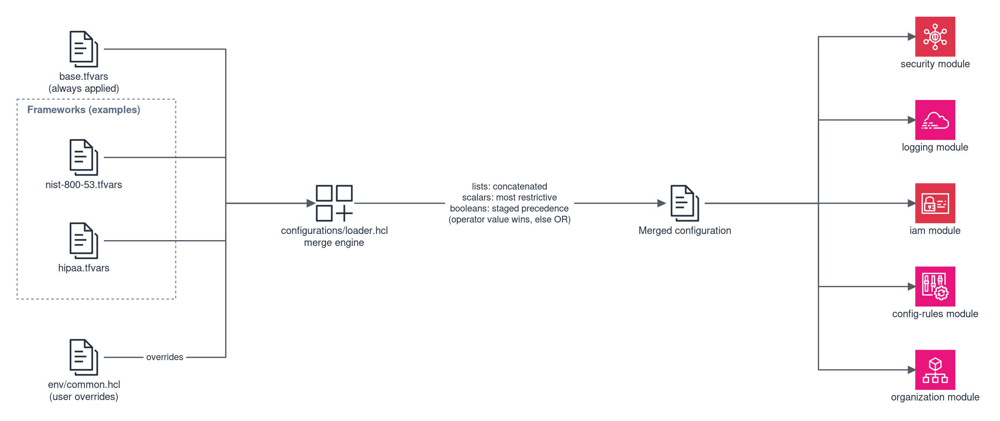

# Compliance Configurations

The `configurations/` directory provides modular, framework-specific compliance configuration files that feed into the Landing Zone's existing Terraform modules. Each framework is independently toggleable and provides framework-specific Config Rules, SCPs, Security Hub standards, password policies, log retention settings, KMS key definitions, and IAM permission boundaries.

> **These configurations do not, by themselves, make you compliant.** They configure technical infrastructure controls — one layer of a comprehensive compliance program. Compliance with any framework requires additional organizational, procedural, physical, and application-level controls that are outside the scope of any infrastructure automation tool. You are responsible for assessing and validating that your complete environment meets your regulatory requirements.

## Directory Structure

```
configurations/
├── README.md                          # Quick-start guide, cost, migration
├── loader.hcl                         # Terragrunt merge engine
├── base/
│   └── base.tfvars                    # Security baseline (always applied)
└── frameworks/
    ├── nist-800-53.tfvars
    ├── hipaa.tfvars
    ├── cmmc.tfvars
    ├── fedramp-moderate.tfvars
    ├── fedramp-high.tfvars
    ├── c5-2020.tfvars
    ├── iso-27001.tfvars
    └── nist-800-171.tfvars
```

## Available Frameworks

| Framework | File | Focus |
|---|---|---|
| NIST 800-53 | `nist-800-53.tfvars` | US Federal information security (Rev. 5) |
| HIPAA | `hipaa.tfvars` | Healthcare — PHI protection safeguards |
| CMMC | `cmmc.tfvars` | US Defense supply chain (Level 2) |
| FedRAMP Moderate | `fedramp-moderate.tfvars` | US Federal cloud services (Moderate baseline) |
| FedRAMP High | `fedramp-high.tfvars` | US Federal cloud services (High baseline) |
| BSI C5:2020 | `c5-2020.tfvars` | German cloud compliance criteria |
| ISO 27001 | `iso-27001.tfvars` | International information security management |
| NIST 800-171 | `nist-800-171.tfvars` | Controlled Unclassified Information (CUI) protection |

## How It Works

### Activation

Set `compliance_frameworks` in `env/common.hcl`:

```hcl
# env/common.hcl
compliance_frameworks = ["nist-800-53"]
```

Multiple frameworks can be enabled simultaneously:

```hcl
compliance_frameworks = ["hipaa", "nist-800-53"]
```

When `compliance_frameworks` is empty (the default), no framework-specific resources are created — only the base security baseline applies.

### Merge Behavior

The configuration loader (`configurations/loader.hcl`) reads the base config and all enabled framework configs, then merges them:



| Data Type | Merge Rule | Example |
|---|---|---|
| Lists | Concatenation | `managed_rules`, `service_control_policies`, `kms_keys` — all rules from all frameworks are included |
| Sets | Union (deduplicated) | `security_hub_standards` — duplicate standards are removed |
| Scalars (retention) | Maximum (most restrictive) | `log_retention_days` — if HIPAA says 2555 and NIST says 365, result is 2555 |
| Scalars (password age) | Minimum (most restrictive) | `password_policy.max_age` — if CMMC says 60 and NIST says 90, result is 60 |
| Scalars (password length) | Maximum (most restrictive) | `password_policy.minimum_length` — highest value wins |
| Booleans (operator value set in `env/common.hcl`) | Staged precedence — the operator's value wins, including `false` | `enable_macie = false` in `env/common.hcl` disables Macie on the next apply, even though `base.tfvars` ships `true` |
| Booleans (operator value unset) | OR over `base.tfvars` and frameworks | `enable_guardduty` — if the baseline or any framework enables it, it stays enabled |
| Password policy | Field-by-field | Each field uses its own merge rule (see above) |
| Network defaults | Advisory (opt-in) | Only applied when `apply_network_defaults = true` |

#### Boolean precedence rule (staged)

Boolean switches are merged in stages: base default < framework overlay < operator. The loader distinguishes *unset* from *false* via `try(local.common.locals.<key>, null)` — `null` means the operator did not set the key, so the OR over `base.tfvars` and the enabled frameworks decides; any non-null value is an operator decision and wins outright, including `false`. Omitting a key (or setting it to `null`) in `env/common.hcl` never counts as `false`.

Consequence on the next apply: a service the operator sets to `false` is really disabled. For example, `enable_macie = false` in a live `env/common.hcl` means Macie stops being enabled by this configuration — the operator's cost decision takes effect. The four boolean fields of the password policy are exempt: they are merged field-by-field using the most restrictive value (see the password policy row) and remain a documented security floor.

### What Gets Merged Into Which Module

| Variable | Target Module | Merge Rule |
|---|---|---|
| `managed_rules` | config-rules | concatenate |
| `custom_rules` | config-rules | concatenate |
| `conformance_packs` | config-rules | concatenate |
| `remediation_configs` | config-rules | concatenate |
| `service_control_policies` | organization | concatenate |
| `resource_control_policies` | organization | concatenate |
| `security_hub_standards` | security | union |
| `security_hub_disabled_controls` | security | concatenate |
| `security_hub_automation_rules` | security | concatenate |
| `password_policy` | security | field-by-field |
| `kms_keys` | security | concatenate |
| `log_retention_days` | logging | max |
| `cloudwatch_log_group_retention` | logging | max |
| `cloudtrail_insights` | logging | union |
| `customer_managed_policies` | iam | concatenate |
| `networking_defaults` | networking | advisory (opt-in) |

## Framework SCPs Require Targets

Four framework configurations define Service Control Policies. Every entry ships with `targets = []`: enabling the framework creates the policy in AWS Organizations but attaches it to nothing — an unattached SCP restricts no account. Attaching a guardrail is a deliberate operator decision (which OUs, which accounts, what blast radius), so the configurations do not choose targets for you.

| Framework | SCPs created (unattached until targets are set) |
|---|---|
| CMMC | `cmmc-data-residency`, `cmmc-restrict-unapproved-services` |
| FedRAMP Moderate | `fedramp-mod-region-restriction`, `fedramp-mod-enforce-encryption` |
| FedRAMP High | `fedramp-high-region-restriction`, `fedramp-high-enforce-encryption`, `fedramp-high-restrict-non-authorized-services` |
| HIPAA | `hipaa-restrict-non-eligible-services` |

The organization module reports every created SCP without a target at plan time (`check "scp_without_targets"`), naming the affected policies. The warning disappears once each entry carries at least one target.

To attach a framework SCP, set its `targets` list in the framework file to OU names or 12-digit account IDs:

```hcl
# configurations/frameworks/fedramp-high.tfvars
service_control_policies = [
  {
    name        = "fedramp-high-region-restriction"
    # ...
    targets     = ["Workloads"] # OU names or account IDs
  },
]
```

Before attaching, check the target's quota headroom: AWS Organizations attaches at most 5 SCPs directly per target, and the organization module counts framework SCPs together with the quarantine and pipeline SCPs against that limit.

## Multi-Partition Handling (aws-eusc)

When `partition = "aws-eusc"` in `env/common.hcl`, the configuration loader automatically filters out resources incompatible with the European Sovereign Cloud:

- **Macie** — disabled entirely (service not available in aws-eusc)
- **Config Rules** — rules referencing unavailable services (e.g., `MACIE_STATUS`) are excluded
- **Security Hub standards** — standards listed in the `eusc_excluded_standard_suffixes` exclusion list in `loader.hcl` are excluded. The list ships empty: which standards are unavailable in aws-eusc is an operator decision — add the `arn_suffix` values of unavailable standards (e.g., `nist-800-53/v/5.0.0`) to activate the filter

The Macie and Config Rules filtering needs no manual intervention; the Security Hub standards filter takes effect once its exclusion list is populated. The filtering happens at merge time in `loader.hcl`.

## What Configurations Cover

Each framework configuration sets technical infrastructure controls:

- Module toggles (which modules are enabled)
- Security service settings (GuardDuty, Security Hub, Access Analyzer, Macie)
- Security Hub standards (FSBP, CIS, NIST, etc.)
- Log retention periods (365 days to 7 years depending on framework)
- Password policy (minimum length, complexity, max age, reuse prevention)
- AWS Config Rules (framework-specific managed rules with real `source_identifier` values)
- Service Control Policies (region restriction, service restriction, encryption enforcement)
- KMS key definitions (framework-specific encryption keys)
- IAM permission boundaries (least-privilege policies)
- CloudTrail settings (data events, insights)
- Optional network defaults (hub-and-spoke, Network Firewall)

## What Configurations Do NOT Cover

Configurations address a subset of technical controls only. Each framework file documents in inline comments which areas require additional work. Common areas not covered:

- Organizational controls (policies, procedures, governance)
- Personnel security (background checks, training)
- Physical security (data center access)
- Incident response processes and runbooks
- Business continuity and disaster recovery planning
- Application-level encryption and access controls
- Network segmentation specific to your workloads
- Audit and assessment processes
- Third-party risk management
- Data classification and handling procedures

## Creating Custom Frameworks

Create a new `.tfvars` file in `configurations/frameworks/`:

```bash
cp configurations/frameworks/nist-800-53.tfvars configurations/frameworks/my-framework.tfvars
```

Edit the file to match your requirements. Each framework file uses standard Terraform variable syntax — no special format. The file must define variables that match the target module interfaces (see the [Configuration Reference](configuration-reference.md) for variable details).

Then add the framework name to `loader.hcl`'s `valid_frameworks` list and enable it:

```hcl
# env/common.hcl
compliance_frameworks = ["my-framework"]
```

## Shared Responsibility

This project provides infrastructure automation. Like any infrastructure tool, it operates within the [AWS Shared Responsibility Model](https://aws.amazon.com/compliance/shared-responsibility-model/). AWS is responsible for security of the cloud. You are responsible for security in the cloud — including how you configure, operate, and maintain the resources this tool creates.

The configurations are provided as examples to help you get started. They are not certified, audited, or guaranteed to meet any specific compliance standard. Always consult with your compliance team and qualified assessors.

## Further reading

- [Configuration Reference](configuration-reference.md) — Full variable reference with types, defaults and validations
- [Multi-Partition](multi-partition.md) — Differences between aws and aws-eusc
