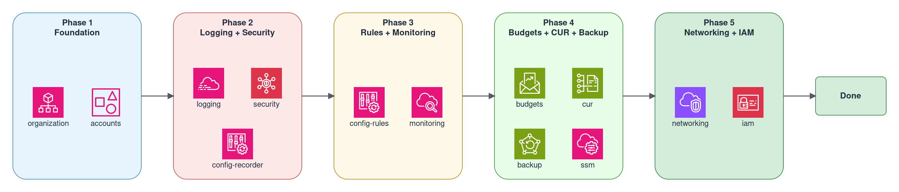

# Getting Started

Step-by-step guide to deploy a landing zone from a blank AWS account.

## Prerequisites

| Tool | Version |
|---|---|
| Terraform | >= 1.14 |
| Terragrunt | >= 1.0 |
| AWS CLI | >= 2.x |

You need Admin credentials in the AWS account that will become the Management Account.

```bash
aws configure --profile your-mgmt-profile
aws sts get-caller-identity --profile your-mgmt-profile
```

Verify the output shows the correct account ID. This account must NOT already be a member of another AWS Organization.

## Control Tower (Optional)

TLZ works with or without AWS Control Tower.

| Mode | Setting | Cross-Account Role |
|---|---|---|
| Without Control Tower | `enable_control_tower = false` | `OrganizationAccountAccessRole` (created automatically by AWS Organizations) |
| With Control Tower | `enable_control_tower = true` | `AWSControlTowerExecution` (created by Control Tower) |

Without Control Tower, TLZ manages CloudTrail, Config, and governance directly. With Control Tower, set it up via the AWS Console first, then enable it in TLZ.

```hcl
# env/common.hcl
enable_control_tower     = false
account_access_role_name = "OrganizationAccountAccessRole"  # or "AWSControlTowerExecution" with CT
```

Two roles, not one, since 0.5.10: `account_access_role_name` is the role the stacks ASSUME to reach
an account that already exists; `created_account_role_name` is the role `CreateAccount` makes inside a
NEW account (unset, the default, means the same name). When the two differ -- for example
`AWSControlTowerExecution` to reach the existing accounts of a Control Tower organization and
`OrganizationAccountAccessRole` for the accounts TLZ creates -- a new account is reachable by the stacks
only once `account_access_role_name` exists inside it: Control Tower enrolment creates that role when it
IS the Control Tower role, otherwise you create it by hand (a role of that name trusting the management
account) before the next org-wide apply. Until then every cross-account unit for that account fails with
`Cannot assume IAM Role` (see Troubleshooting in docs/operations.md).

## 1. Clone and Configure

```bash
git clone <repository-url>
cd terraform-landing-zone
```

Create your local configuration files from the templates:

```bash
cp env/common.hcl.example env/common.hcl
cp env/accounts.hcl.example env/accounts.hcl
```

The `.example` files are committed to the repo with placeholder values. Your local copies (`common.hcl`, `accounts.hcl`) are gitignored — they contain your real AWS profile, email addresses, and account IDs.

Edit `env/common.hcl` with your values:

```hcl
locals {
  region            = "eu-central-1"        # Your home region
  aws_profile       = "your-mgmt-profile"   # AWS CLI profile name
  partition         = "aws"                  # "aws" or "aws-eusc"
  state_backend     = "local"               # "local" for first deployment; "s3" needs real state_bucket_name/lock_table_name (Deployment Modes)

  # Cross-account role — depends on Control Tower choice
  account_access_role_name = "OrganizationAccountAccessRole"

  # Start with only foundation modules enabled
  enable_organization = true
  enable_accounts     = true
  enable_logging      = false
  enable_security     = false
  enable_iam          = false
  enable_config_rules = false
  enable_networking   = false
  enable_monitoring   = false

  # Account definitions — use unique email addresses per account
  accounts = [
    {
      name                     = "Audit"
      email                    = "you+audit@example.com"
      organizational_unit_name = "Security"
      tags                     = { AccountType = "Audit" }
    },
    {
      name                     = "Log-Archive"
      email                    = "you+logs@example.com"
      organizational_unit_name = "Security"
      tags                     = { AccountType = "Log-Archive" }
    },
  ]
}
```

Leave `env/accounts.hcl` empty for now — the cross-account stacks resolve their account IDs through Terragrunt dependencies and SSM parameters. One exception: with `enable_organization = false`, set `management_account_id`; nothing else supplies it to `audit/security-org-config`, which otherwise enrols no management account.

`stacks/management/config-rules` evaluates member accounts once the Audit account ID resolves, the same way the recorder stacks resolve it: `audit_account_id` in `env/accounts.hcl` when set, otherwise the SSM parameter `/tlz/accounts/Audit/id` that Pass 1 writes (or `enable_config_recorder_members = true`). Before the Audit account exists it excludes every member account from every organization Config rule and conformance pack. Conformance packs are organization packs: they reach the same member accounts as the rules.

Turn on Terragrunt's provider cache in the shell before the first `terragrunt run --all`. Without it every unit downloads and unpacks its own copy of the AWS provider:

```bash
export TG_PROVIDER_CACHE=1   # one provider download for all units; the cache server listens on localhost only
```

## 2. Phase 1 — Foundation (Organization + Accounts)

This creates the AWS Organization, OUs, SCPs, and member accounts. Requires two passes on the first deployment:

```bash
# Pass 1: Create Organization, OUs, policies, and accounts
(cd stacks && terragrunt run --all -- apply)    # Creates: Org, 8 OUs, SCPs, Accounts, SSM parameters

# Before Pass 2: the AWS Config recorders reference the service-linked role
# AWSServiceRoleForConfig and no stack creates it. Create it once in every
# account that gets a recorder (management, Audit, Log-Archive, workload
# accounts), with a profile for that account; config.<dns_suffix> outside the
# aws partition. "has been taken" means the role exists already. The recorders
# follow enable_logging and come with Phase 2; the accounts exist after Pass 1.
aws iam create-service-linked-role --aws-service-name config.amazonaws.com --profile <account-profile>

# Pass 2: Deploy the cross-account stacks of the Audit account
# These resolve account IDs from the plain-ID parameters
# (/tlz/accounts/<AccountName>/id) written in Pass 1
(cd stacks && terragrunt run --all -- apply)    # Deploys: the account-level security baseline of the Audit account
```

With the Phase 1 toggles, Pass 2 deploys `audit/security-config`: the password policy and the other account-level settings of the Audit account. A unit whose dependency is switched off is skipped: the config recorders in the Audit, Log-Archive and workload accounts follow `enable_logging` and come with Phase 2, and `audit/security-org-config` follows `enable_security`.

After the first deployment, all subsequent changes are single-pass: `(cd stacks && terragrunt run --all -- apply)`.

Adding an account later: declare it in `accounts` with its final `organizational_unit_name` and `quarantined = true`, then `(cd stacks && terragrunt run --all -- apply)`. The accounts stack creates it inside the quarantine OU (`quarantine_ou_name`, `Quarantine` in the example), where the quarantine SCP already applies, and the cross-account stacks configure it through the access role the SCP exempts. The plan names the quarantined accounts on every run. Release it once configured: set `quarantined = false` and apply `stacks/management/accounts`, which moves the account to its declared OU. With `enable_quarantine_scp = false` leave the flag out; a quarantined account without a quarantine OU is refused at plan time.

Account IDs flow automatically — the accounts stack writes one plain-ID parameter per account (`/tlz/accounts/<AccountName>/id`, plus a `/metadata` JSON record), and the cross-account stacks resolve the plain ID at parse time. The security stack registers delegated admin for GuardDuty, SecurityHub, Macie, and Access Analyzer automatically. Other delegated administrators (for example Firewall Manager, IPAM or Identity Center) go into `service_access_principals` in `env/common.hcl` once their account IDs exist, and each such service also needs trusted access, from a toggle or from `additional_aws_service_access_principals`.

Verify cross-account access works:

```bash
# Get the Audit account ID from the accounts output
(cd stacks/management/accounts && terragrunt output account_ids)

# Test cross-account role assumption
aws sts assume-role \
  --role-arn "arn:aws:iam::<AUDIT_ACCOUNT_ID>:role/OrganizationAccountAccessRole" \
  --role-session-name test \
  --profile your-mgmt-profile \
  --query 'Credentials.AccessKeyId'
```

If this returns an access key, proceed to Phase 2.

## 3. Phase 2 — Logging + Security

Enable logging and security in `env/common.hcl`:

```hcl
enable_logging  = true
enable_security = true
```

```bash
# Central logging (CloudTrail, Config Recorder, S3 bucket, KMS)
(cd stacks/management/logging && terragrunt plan && terragrunt apply)

# Config Recorder in each member account
(cd stacks/audit/config-recorder && terragrunt plan && terragrunt apply)

(cd stacks/log-archive/config-recorder && terragrunt plan && terragrunt apply)

# Security services (GuardDuty, SecurityHub, Macie, Access Analyzer)
(cd stacks/management/security && terragrunt plan && terragrunt apply)

# Delegated admin config (from Audit account) — org configuration and, with
# security_finding_consumers_in_audit (default true), the finding consumers:
# GuardDuty and Macie export into the central bucket, Security Hub aggregator,
# automation rules and member enrolment
(cd stacks/audit/security-org-config && terragrunt plan && terragrunt apply)
```

## 4. Phase 3 — Governance (Config Rules + Monitoring)

```hcl
enable_config_rules = true
enable_monitoring   = true
```

```bash
(cd stacks/management/config-rules && terragrunt plan && terragrunt apply)

(cd stacks/management/monitoring && terragrunt plan && terragrunt apply)

# Alerting on the whole organization's findings (from Audit account); runs
# with security_finding_consumers_in_audit, after audit/security-org-config
(cd stacks/audit/monitoring && terragrunt plan && terragrunt apply)
```

The `iam` stack belongs to Phase 5. It depends on `networking`: Managed Microsoft
AD and the AD Connector are placed in a VPC, and only the networking stack knows
the VPC and subnet identifiers. `terragrunt apply` on `iam` therefore needs the
state of `networking`.

## 5. Phase 4 — Extensions (Budgets, CUR, Backup)

```hcl
enable_budgets                 = true
enable_cost_and_usage_report   = true
```

```bash
(cd stacks/management/budgets && terragrunt plan && terragrunt apply)

(cd stacks/management/cur && terragrunt plan && terragrunt apply)

(cd stacks/management/backup && terragrunt plan && terragrunt apply)

(cd stacks/management/ssm-parameters && terragrunt plan && terragrunt apply)
```

## 6. Phase 5 — Networking and IAM

Networking is optional — enable it only if you have VPCs, Transit Gateway, or
Network Firewall configured. `iam` comes after it in either case, because the
directory services read the VPC and subnet identifiers from the networking
stack. Without a configured `managed_active_directories` both values arrive
empty, which is the module default and creates no directory.

```hcl
enable_networking = true
enable_iam        = true
```

```bash
(cd stacks/management/networking && terragrunt plan && terragrunt apply)

(cd stacks/management/iam && terragrunt plan && terragrunt apply)
```

## 7. Verify Deployment

After all phases complete:

```bash
# Drift-free check — should show no changes
(cd stacks && terragrunt run --all -- plan)

# Verify Config Recorder in the management account
aws configservice describe-configuration-recorder-status \
  --profile your-mgmt-profile --region eu-central-1

# Verify GuardDuty is active
aws guardduty list-detectors --profile your-mgmt-profile --region eu-central-1
```

## Deployment Phases Overview



## Compliance Configurations

After the base deployment, enable a compliance framework:

```hcl
# env/common.hcl
compliance_frameworks = ["nist-800-53"]
```

Available: `nist-800-53`, `hipaa`, `cmmc`, `fedramp-moderate`, `fedramp-high`, `c5-2020`, `iso-27001`, `nist-800-171`

Multiple frameworks can be combined:

```hcl
compliance_frameworks = ["hipaa", "nist-800-53"]
```

Then re-apply all stacks:

```bash
(cd stacks && terragrunt run --all -- plan)
(cd stacks && terragrunt run --all -- apply)
```

See [Compliance Configurations](compliance-configurations.md) for details on what each framework covers.

## Multi-Partition (aws-eusc)

For European Sovereign Cloud:

```hcl
# env/common.hcl
region    = "eusc-de-east-1"
partition = "aws-eusc"
```

Services unavailable in aws-eusc (e.g. Macie) are automatically skipped.

## Deployment Modes

| Mode | Config | Use Case |
|---|---|---|
| Local state | `state_backend = "local"` | First deployment, experimentation |
| S3 remote state | `state_backend = "s3"` | Team collaboration (set real bucket and lock table names, then apply bootstrap first — see below) |
| Deployment account | `enable_deployment_account = true` | State bucket and pipeline in a second account — see [Deployment account mode](#deployment-account-mode) |
| Pipeline | `enable_pipeline = true` | CI/CD (requires Deployment Account + S3) |

With `state_backend = "local"`, each unit's state is written to a stable
absolute path **outside the repository**: `$TLZ_STATE_DIR/<unit>/terraform.tfstate`,
defaulting to `~/.tlz-state/<unit>/terraform.tfstate` (keyed per unit like
the S3 key) — **not** inside `.terragrunt-cache` and **not** inside the repo.
Both halves matter: a cache generation is disposable and gets re-hashed on
config changes, and a gitignored in-repo location is exactly what
`git clean -xfd` deletes. Several TLZ deployments on one machine need one
`TLZ_STATE_DIR` per clone, or the second clone is refused (see
[Operations](operations.md), one directory per deployment). Deployments that ran
before this behaviour existed have state inside the cache or under the
interim `<repo>/.state/` — see [Operations](operations.md) for the one-time
migration.

For S3 mode on a new deployment, set the backend first and create the bucket
second. `stacks/management/bootstrap` creates the state bucket and the
DynamoDB lock table from the names in `env/common.hcl`, and it refuses to run
while that file sets any other backend: `terragrunt run --all` skips it, and a
direct `init`, `plan` or `apply` stops with
`ERROR: stacks/management/bootstrap creates the S3 bucket ...`.

1. In `env/common.hcl`, set `state_backend = "s3"` and replace the
   placeholders of `state_bucket_name` (bucket names are globally unique) and
   `lock_table_name` with the real names.
2. Apply the bootstrap unit on its own, before any other unit. The
   subshell keeps you in the repository root, where the next step starts:
   ```bash
   (cd stacks/management/bootstrap && terragrunt apply)
   ```
   No unit depends on it, so `run --all` would initialise the others against
   a bucket that does not exist yet. The bootstrap unit's own state stays
   local, at `$TLZ_STATE_DIR/management/bootstrap/terraform.tfstate` (default
   `~/.tlz-state/...`), not in the bucket — keep that directory.
3. Then deploy the other stacks, starting with
   [Phase 1](#2-phase-1-foundation-organization-accounts); they keep their
   state in the bucket from the first init on.

A deployment that already holds local state does not follow these steps: it
moves its state as described in [Operations — Switching the backend from local
to S3](operations.md#switching-the-backend-from-local-to-s3).

### Deployment account mode

With `enable_deployment_account = true` the state bucket, the lock table and
the optional key live in a second account, the deployment account, and so does
the pipeline. Every unit then runs as your profile in the management account
and its state backend assumes `account_access_role_name` in the deployment
account; the pipeline later walks the same path through a profile its build
writes (see [Architecture — Credential chain](architecture.md#credential-chain)).
`stacks/management/bootstrap` is never applied in this mode: `run --all` skips
it and a direct call stops with `ERROR: stacks/management/bootstrap is not the
state backend of this deployment`. The deployment account is a precondition,
like the management account — it is not an entry of `accounts`, so the
per-account units do not reach it; the organization-level services do.

1. The organization exists — [Phase 1](#2-phase-1-foundation-organization-accounts)
   with the mode off, on local or S3 state as above. For a fresh organization,
   run pass 1 of Phase 1 with the mode off and `state_backend = "local"`; the
   state move of step 7 then applies.
2. Create the deployment account with the role `account_access_role_name`
   (`aws organizations create-account --role-name <account_access_role_name>`
   or Control Tower Account Factory), place it in the Infrastructure OU, and
   wait for `ACTIVE`.
3. In `env/accounts.hcl`, set `management_account_id`, `deployment_account_id`
   and every other id. In `env/common.hcl`, set `state_backend = "s3"`, real
   `state_bucket_name` and `lock_table_name` (a NEW bucket name if a management
   bucket exists), `enable_deployment_account = true`, `enable_pipeline = false`
   and `pipeline_scp_infrastructure_ou_id` from the organization output.
4. Check the hop before anything is created; on a refusal stop here:
   ```bash
   aws sts assume-role --role-arn arn:aws:iam::<deployment-account-id>:role/<account_access_role_name> --role-session-name probe --profile <aws_profile>
   ```
5. Create the bucket, the table and the key in the deployment account. The
   unit's own state stays local, at
   `$TLZ_STATE_DIR/deployment/bootstrap/terraform.tfstate`:
   ```bash
   (cd stacks/deployment/bootstrap && terragrunt apply)
   ```
6. New organization: `(cd stacks && terragrunt run --all -- apply)` twice, pass 1
   and pass 2 as in the phases above. Existing deployment: step 7 first.
7. Existing state (local or a management bucket): move it with the procedure in
   [Operations — Migrating local state out of the repository](operations.md#migrating-local-state-out-of-the-repository),
   the destination being `s3://<new bucket>` reached through `aws sts assume-role`
   into the access role of step 4. Then `(cd stacks && terragrunt run --all -- plan)`
   must show three changes and nothing else: the SSM parameters `/tlz/accounts/*`
   moving from the management to the deployment account, the Pipeline SCP
   (`management/organization`, from `pipeline_scp_infrastructure_ou_id` of step 3)
   and `TLZDeploymentRole` in the management account (`management/deployment-role`).
8. Pipeline: set `enable_pipeline = true`, `pipeline_type` and the source keys,
   then `(cd stacks && terragrunt run --all -- apply)` creates the pipeline in
   the deployment account. Commit
   `env/common.hcl` and `env/accounts.hcl` to the repository the pipeline builds
   (`git add -f` once; this repository's `.gitignore` keeps them out here) and
   push. The first run's Plan stage is the proof that the deployment role's
   policy suffices; approve, and the Apply stage runs.

Rollback before step 7: empty the deployment bucket and set the flag off.
After step 7: the reverse move. The former management bucket keeps its
content until you empty and delete it by hand (its bootstrap unit refuses a
direct call in this mode).

## Destroy

By default, destroying does not close member accounts; with
`close_on_deletion = true` it does. With `close_on_deletion = false`
(the default), each account stays open and keeps billing. The provider's
destroy calls `RemoveAccountFromOrganization`. AWS refuses that call for an
account with no payment method of its own, which is every account this
landing zone creates, so the account stays `ACTIVE` in the organization.
If the call does go through, the account becomes a standalone account
outside every organization policy and gets its own bill. To close accounts,
do one of the following from the management account:

- Set `close_on_deletion = true` in `env/common.hcl` and apply the accounts
  stack before you destroy. The destroy then calls `CloseAccount`.
- Close each account yourself with
  `aws organizations close-account --account-id <account-id>` or in the
  Organizations console.

Either way, the account goes `PENDING_CLOSURE` and then `SUSPENDED`. AWS
Support can reinstate it within 90 days. Organizations closes at most 10% of
member accounts (10 to 1000) per rolling 30 days. When you hit that limit,
`CLOSE_ACCOUNT_QUOTA_EXCEEDED` stops the destroy and you close the rest later.

```bash
# Entire landing zone, local backend (reverse dependency order;
# run --all skips both bootstrap units in this mode)
(cd stacks && terragrunt run --all -- destroy)

# Single module
(cd stacks/management/networking && terragrunt destroy)
```

On the S3 backend, leave the bootstrap unit that holds the state for last. Its
state bucket and lock table hold the state of every other unit, and no unit
depends on it, so a plain `run --all` would destroy it in its first wave. Which
unit that is follows `enable_deployment_account`: off, `stacks/management/bootstrap`;
on, `stacks/deployment/bootstrap` (the management bootstrap is never applied in
that mode, and each unit's `exclude` keeps the other one out of the run).
Exclude it from the run, then destroy it on its own:

```bash
# Entire landing zone, S3 backend, enable_deployment_account = false
(cd stacks && terragrunt run --all --filter '!./management/bootstrap' -- destroy)
(cd stacks/management/bootstrap && terragrunt destroy)

# Entire landing zone, S3 backend, enable_deployment_account = true
(cd stacks && terragrunt run --all --filter '!./deployment/bootstrap' -- destroy)
(cd stacks/deployment/bootstrap && terragrunt destroy)
```

The state bucket is versioned and has no `force_destroy`, so AWS refuses to
delete it while it still holds state files; empty it first if it has to go.

## Further reading

- [Configuration Reference](configuration-reference.md) — Full variable reference with types, defaults and validations
- [Operations](operations.md) — Day-2 operations, troubleshooting and state management
- [Compliance Configurations](compliance-configurations.md) — Enable and combine framework-specific configurations
