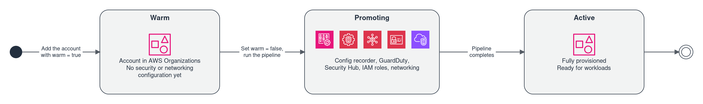

# Operations

Day-2 operations, state management, and troubleshooting.

## Deploying Changes

```bash
cd stacks
terragrunt run --all -- plan     # Preview
terragrunt run --all -- apply    # Apply

# Single module
cd stacks/management/security
terragrunt plan && terragrunt apply
```

Before the FIRST org-wide apply against accounts that an earlier deployment already populated, import what already lives there: [Importing the Existing Deployment](import-existing-deployment.md) (46 objects, one-time, by hand).

## Enabling/Disabling Modules

Toggle in `env/common.hcl`, then apply. Disabled modules are skipped. Dependent modules are also skipped.

## Adding Accounts

Add to `accounts` list in `env/common.hcl`. Apply the accounts stack. Account IDs propagate via dependency outputs. Create a config-recorder stack for the new account.

## Account Warming and Onboarding

TLZ supports a warm/promote pattern for account onboarding, using Terragrunt per-account stacks for baseline provisioning.

### Warm Account Lifecycle



1. **Create warm account** — Add to `env/common.hcl` with `warm = true`:
   ```hcl
   {
     name                     = "NewWorkload"
     email                    = "admin+newworkload@example.com"
     organizational_unit_name = "Workloads/Prod"
     warm                     = true
     tags                     = { AccountType = "Workload" }
   }
   ```
   Run `terragrunt run --all -- apply` on the accounts stack. The account is created in AWS Organizations but skips security/networking configuration.

2. **Promote warm account** — Set `warm = false` on the account entry, then run the full Terragrunt pipeline:
   ```bash
   cd stacks
   terragrunt run --all -- apply
   ```
   This provisions: Config Recorder, GuardDuty enrollment, SecurityHub enrollment, IAM baseline roles, networking (VPC, TGW attachment), and monitoring.

3. **Identify warm accounts** — The `warm_account_ids` output from the accounts module lists all accounts awaiting promotion. Use this in downstream automation:
   ```bash
   cd stacks/management/accounts
   terragrunt output warm_account_ids
   ```

## Pipeline Mode Bootstrap

Phase 1: Create accounts + state backend. Phase 2: Deploy pipeline. Phase 3: Push to main — pipeline takes over. After that, local execution is only for bootstrap and emergencies.

## State Management

Each module has its own S3 state. Use `terragrunt state list` in any stack directory. Force-unlock with `terraform force-unlock <LOCK_ID>` if needed.

### Local backend (`state_backend = "local"`)

With `state_backend = "local"`, state lives **outside the repository** at
`$TLZ_STATE_DIR/<unit>/terraform.tfstate` — `$HOME/.tlz-state/<unit>/terraform.tfstate`
when `TLZ_STATE_DIR` is unset — keyed per unit exactly like the S3 key
(e.g. `management/security`). The path is set in `stacks/root.hcl` and
repeated verbatim in the two bootstrap units (they do not include root).
Three rules:

- **Absolute.** Terraform's local backend resolves a relative path against
  its working directory, which under Terragrunt is the `.terragrunt-cache`
  generation; any `env/*.hcl` edit re-hashes the unit and orphans the state.
  A parse-time guard aborts on a relative `TLZ_STATE_DIR` (or unset `HOME`).
- **Outside the repo.** A gitignored directory inside the repository, such
  as `<repo>/.state/`, is exactly what `git clean -xfd` deletes. Live state
  must never sit where a routine git command removes it.
- **One directory per deployment.** The default is shared per user. If one
  machine hosts several TLZ deployments, set `TLZ_STATE_DIR` per clone
  (shell profile or direnv) — otherwise both deployments read and write the
  *same* per-unit state files. This is enforced: the first
  plan, apply or render in a state directory writes `<state_dir>/.tlz-clone`
  carrying the clone's absolute repository path, and a run from a *different*
  clone is refused before any backend is initialised, with a message that
  names both clones and both ways out — `export TLZ_STATE_DIR=<dir>` for the
  second clone, or remove `<state_dir>/.tlz-clone` if the clone it names is
  gone for good. Removing the marker does not remove the per-unit state
  files already in that directory: they stay, and belong to whichever clone
  runs next — move them out first if the old deployment's state is to be
  kept. A clone that is moved or renamed is refused by its own marker too,
  since its repository path has changed; the same remedy (remove the marker)
  applies. A single clone never notices the marker; `state_backend =
  "s3"` writes none. If you choose a custom `TLZ_STATE_DIR`, it
  must be set in **every** session: a session without it silently falls back
  to `~/.tlz-state`, sees empty state, and plans to re-create the world.

### Migrating local state out of the repository

For a deployment whose state sits at the old interim path
`<repo>/.state/<unit>/terraform.tfstate`. The per-unit keying is identical on
both sides, so the move is a tree copy — but the verification is not
optional: one unit's state in the reference deployment had to be
hand-reconciled from two split cache generations, and a wrong step here
silently overwrites exactly that kind of file.

**Never use `terraform init -migrate-state` and never `-force-copy`.** Both
copy the backend-*recorded* old state over the destination file. If the old
record points at a stale or split state (the exact situation the hand-
reconciled unit was rescued from), the reconciled file is destroyed. If any
init ever asks *"Do you want to copy existing state to the new backend?"* —
answer **no** and treat it as a failed precondition: a stale backend record
survived step 4.

1. **Stop.** No `terraform`/`terragrunt` command may run against this
   deployment until step 6 has passed for every unit.
2. **Choose the destination.** Default: `~/.tlz-state` (recommended for a
   single deployment). Custom: `export TLZ_STATE_DIR=/abs/path` — absolute,
   outside the repository, persisted in your shell profile.
3. **Back up, then copy.** From the repo root:
   ```bash
   tar -czf ~/tlz-state-backup-$(date +%Y%m%d-%H%M%S).tar.gz .state
   mkdir -p ~/.tlz-state          # or "$TLZ_STATE_DIR"
   cp -a .state/. ~/.tlz-state/
   diff -r .state ~/.tlz-state    # must print nothing
   ```
4. **Remove the stale backend records.** Each deployed unit's
   `.terragrunt-cache` holds a backend record pointing at the old path; left
   in place, the next init offers the state-copy prompt from the warning
   above. The cache holds **no live state** (state moved out of it in the
   previous migration), so it is safe to delete wholesale:
   ```bash
   find stacks -type d -name .terragrunt-cache -prune -exec rm -rf {} +
   ```
   Do **not** use `git clean -xfd` for this while `<repo>/.state` still
   exists — it would delete that too.
5. **Record the pre-move instance counts** from the copied files (one line
   per resource instance, the same thing `terragrunt state list` counts):
   ```bash
   for f in $(find ~/.tlz-state -name terraform.tfstate | sort); do
     echo "$f: $(jq '[.resources[].instances | length] | add' "$f")"
   done
   ```
6. **Verify every unit through Terragrunt** (this re-inits against the new
   path — watch for the forbidden copy prompt):
   ```bash
   cd stacks/<unit> && terragrunt state list | wc -l
   ```
   The count must equal step 5's number for that unit. The table shows a
   reference deployment (all under `stacks/management/`). These are resource
   **instances** — what `terragrunt state list` and step 5's `jq` both count —
   NOT the number of `resources` entries in the state file, which differs in
   both directions: a `count = 0` resource keeps an entry with zero instances,
   while a `for_each` resource is one entry with many. Comparing the wrong
   metric makes a healthy migration look broken.

   | Unit | Instances |
   |---|---|
   | organization | 53 |
   | accounts | 12 |
   | logging | 40 |
   | monitoring | 35 |
   | backup | 5 |
   | config-rules | 38 |
   | budgets | 1 |
   | security | 78 |

   A unit listing **0 resources** means the wrong path is being read — check
   `TLZ_STATE_DIR`, check the copy — **stop; do not plan or apply.**
7. **Plan-check one small unit read-only** (e.g. budgets, 1 instance):
   `terragrunt plan` must not want to *create* resources that exist live —
   a create-the-world plan means empty or wrong state, even if step 6 looked
   plausible.
8. **Only after all units pass 6 and 7**, retire the old tree — move it
   aside first, delete later:
   ```bash
   mv .state .state.migrated-$(date +%Y%m%d)
   ```
   (S3-mode deployments: the same copy already covered the bootstrap units'
   local state at `.state/management/bootstrap/` and
   `.state/deployment/bootstrap/`, since the keying is identical.)

**Deployments whose state still sits inside `.terragrunt-cache`** (never
migrated to the interim `.state/` scheme): follow the procedure in the
comment above `remote_state` in `stacks/root.hcl` — select the authoritative
file per unit **by content, never by mtime** (non-empty `resources`, then
highest `serial` within one `lineage`; the orphaning bug means the newest
generation often holds the *empty* state), and copy it directly to
`$TLZ_STATE_DIR/<unit>/terraform.tfstate` (default `~/.tlz-state/...`). Then
verify with steps 6–7 above.

### Switching the backend from local to S3

Turning `state_backend = "local"` into `"s3"` in `env/common.hcl` is a single
edit that moves **every** unit at once: all 29 units that include
`stacks/root.hcl` re-key their backend on the next init. Two units are exempt
by construction — `stacks/management/bootstrap` and
`stacks/deployment/bootstrap` pin `backend = "local"` in their own
`terragrunt.hcl`, so their state stays local and is never uploaded.

Preconditions:

- **The bucket and the lock table must exist, and the state must already be
  in the bucket.** `stacks/management/bootstrap` creates both from
  `state_bucket_name` and `lock_table_name`. Flipping the switch against an
  **empty** bucket is the trap: every unit then reads 0 resources, and the
  next plan wants to create everything that is already live.
- **Keying is identical on both sides.** Local
  `$TLZ_STATE_DIR/<unit>/terraform.tfstate` versus S3 key
  `<unit>/terraform.tfstate` — the move is a per-file upload, nothing is
  renamed.
- **From the flip onwards every operation takes a DynamoDB lock.** The table
  must be `ACTIVE`; a killed run leaves a stale lock, cleared per unit with
  `terragrunt force-unlock <lock-id>`.

**Never use `terraform init -migrate-state` and never `-force-copy`** — same
reason as the section above. Upload the files first, then init with
`-reconfigure`, which drops the stale backend record instead of copying from
it.

1. **Stop.** No `terraform`/`terragrunt` command against this deployment
   until step 6 has passed for every unit that holds state.
2. **Record the pre-move instance counts** from the local files:
   ```bash
   S=${TLZ_STATE_DIR:-$HOME/.tlz-state}
   for f in $(find "$S" -name terraform.tfstate | sort); do
     echo "$f: $(jq '[.resources[].instances | length] | add // 0' "$f")"
   done
   ```
3. **Upload each unit's state to its key.** Derive the list from the state
   directory instead of typing it — a hard-coded list silently skips a unit
   that gained local state after this section was written. The two bootstrap
   units are excluded because each pins `backend = "local"` in its own
   `terragrunt.hcl`, so their state never moves to S3 and `$TLZ_STATE_DIR`
   must not be deleted afterwards.
   ```bash
   B=$(grep -oP 'state_bucket_name\s*=\s*"\K[^"]+' env/common.hcl)
   UNITS=$(cd "$S" && find . -name terraform.tfstate \
     | sed 's|^\./||; s|/terraform\.tfstate$||' \
     | grep -vxE 'management/bootstrap|deployment/bootstrap' | sort)
   echo "$UNITS"   # read the list before uploading anything
   for u in $UNITS; do
     aws s3 cp "$S/$u/terraform.tfstate" "s3://$B/$u/terraform.tfstate"
   done
   ```
4. **Verify every upload by checksum — equal size is not proof.** For a
   single-part upload the ETag is the MD5 of the object. This must be its own
   loop over `$UNITS`: after step 3 the bare variable `$u` still holds only
   the *last* unit, so a single `head-object` call verifies one file while
   reading as though it verified all of them.
   ```bash
   for u in $UNITS; do
     E=$(aws s3api head-object --bucket "$B" --key "$u/terraform.tfstate" \
       --query ETag --output text | tr -d '"')
     M=$(md5sum "$S/$u/terraform.tfstate" | cut -d' ' -f1)
     [ "$E" = "$M" ] && echo "OK       $u" || echo "MISMATCH $u $E $M"
   done
   ```
   Every line must read `OK`, and there must be one line per unit in
   `$UNITS`. A `MISMATCH` means a truncated or half-written object — **stop.**
5. **Flip the switch:** `state_backend = "s3"` in `env/common.hcl`. Back that
   file up first — it is gitignored, so a wrong edit cannot be recovered from
   git.
6. **Verify every unit through Terragrunt:**
   ```bash
   cd stacks/<unit> && terragrunt init -reconfigure && terragrunt state list | wc -l
   ```
   The count must equal step 2's number for that unit. If an init asks *"Do
   you want to copy existing state to the new backend?"* — answer **no**,
   delete that unit's `.terragrunt-cache`, and re-init. A unit listing **0**
   means the wrong key or the wrong bucket — **stop; do not plan or apply.**
7. **Plan-check one unit that holds state:** `terragrunt plan` must print
   `0 to add` and `0 to destroy`. A create-the-world plan means the backend
   is reading an empty key, even if step 6 looked plausible.
8. **Do not delete `$TLZ_STATE_DIR`** — the two bootstrap units keep reading
   their state from it. Once a migrated unit has passed 6 and 7, move only
   that unit's directory aside:
   `mv "$S/<unit>" "$S/<unit>.pre-s3-$(date +%Y%m%d)"`.

On a reference deployment (`management/organization`):
`aws_profile = ""` is passed through unguarded and lands verbatim as
`profile = ""` in the generated `backend.tf` — init accepts it (the two
provider blocks map an empty profile to `null`, `remote_state` does not).
The unit listed 53 instances before and 53 after, and its plan printed
`Plan: 0 to add, 1 to change, 0 to destroy`: a pre-existing no-op diff on one
policy (a single-element list read back as a string), not caused by the move.

## Destroy

```bash
# Local backend (run --all skips both bootstrap units in this mode)
(cd stacks && terragrunt run --all -- destroy)

# S3 backend: the bootstrap units hold the state bucket and lock table of
# every other unit, so exclude them and destroy them last, management last
(cd stacks && terragrunt run --all --filter '!./management/bootstrap' --filter '!./deployment/bootstrap' -- destroy)
(cd stacks/deployment/bootstrap && terragrunt destroy)   # only with enable_deployment_account = true
(cd stacks/management/bootstrap && terragrunt destroy)
```

See [Getting Started — Destroy](getting-started.md#destroy) for the order and
the versioned state bucket.

Accounts with `close_on_deletion = false` (default) are removed from state but not closed in AWS.

With `enable_s3_object_lock` and COMPLIANCE retention, the `guardduty/` marker
object in the central log bucket cannot be deleted until its retention lapses,
so a destroy of the logging unit fails on it even with `force_destroy`. Known
and accepted — wait out the retention or exclude the bucket from the destroy.

## Adding Organizational Units

1. Edit `env/common.hcl` — add the new OU to `organizational_units`:

   ```hcl
   organizational_units = [
     # ... existing OUs ...
     { name = "NewOU", parent_name = "Workloads" },
   ]
   ```

   Use `parent_name = "__root__"` for top-level OUs. Nesting up to 5 levels is supported.

2. Apply the organization stack:

   ```bash
   cd stacks/management/organization
   terragrunt apply
   ```

3. If the new OU needs SCPs, add it to the `targets` list of the relevant SCP in `env/common.hcl` or `configurations/base/base.tfvars`, then re-apply the organization stack.

4. The new OU ID is available in the `ou_name_to_id` output for use by other stacks.

## Managing SCPs

### Adding or modifying an SCP

1. Create or edit the policy JSON in `configurations/policies/organization/`. Organization policies follow the naming convention `tlz-<name>.json`. The subdirectory matters: the loader reads policies per area, so a file placed directly under `configurations/policies/` is never picked up.

2. Add the SCP definition to `service_control_policies` in `env/common.hcl` (for org-level policies) or `configurations/base/base.tfvars` (for baseline guardrails):

   ```hcl
   {
     name        = "my-new-guardrail"
     description = "Description of what this SCP protects."
     content     = "__LOADER_INJECT__"   # loader reads from policies/ by name
     targets     = ["Workloads"]
   }
   ```

3. Apply the organization stack:

   ```bash
   cd stacks/management/organization
   terragrunt apply
   ```

AWS enforces a quota of 5 SCPs per OU or account. Check current attachment counts before adding new policies. Use `aws organizations list-policies-for-target` to verify.

### RCPs and declarative policies

Same workflow — edit `resource_control_policies` or `declarative_policies` in `env/common.hcl`, add the JSON file to `configurations/policies/organization/` using the same `tlz-<name>.json` convention, and apply the organization stack.

## Managing Config Rules

### Adding a new Config Rule

1. Add the rule to `managed_rules` in `configurations/base/managed-rules.json` (the list lives in JSON because `read_tfvars_file` cannot parse nested object structures):

   ```hcl
   {
     name              = "base-my-new-rule"
     source_identifier = "MY_AWS_MANAGED_RULE_IDENTIFIER"
     input_parameters  = {}
     excluded_accounts = []
     deployment_targets = []
     tags              = { ManagedBy = "TLZ" }
   }
   ```

2. Apply the config-rules stack:

   ```bash
   cd stacks/management/config-rules
   terragrunt apply
   ```

### Adding auto-remediation

1. Create an SSM Automation document in `configurations/ssm-documents/`. JSON and YAML are both accepted — the two remediation documents shipped with TLZ are JSON, `resource-policy-enforcement.yaml` is YAML.

2. Register the document in `ssm_documents` in `env/common.hcl`, pointing `content_file` at the file you created.

3. Add a remediation config to `remediation_configs` in `configurations/base/remediation-configs.json`:

   ```hcl
   {
     rule_name   = "base-my-new-rule"
     target_id   = "tlz-my-remediation-doc"
     target_type = "SSM_DOCUMENT"
     parameters  = { ... }
     automatic   = true
     maximum_automatic_attempts = 5
     retry_attempt_seconds      = 60
   }
   ```

4. Apply the config-rules stack.

## Log Analysis

### Central log bucket structure

All logs are stored in the central S3 bucket. The bucket is created by `stacks/management/logging` in the **management account** (the stack has no cross-account provider); its name carries the Log-Archive account ID (`tlz-central-logs-<log_archive_account_id>-<region>`), but the bucket does not live in that account:

| Prefix | Content | Source |
|---|---|---|
| `cloudtrail/` | Organization CloudTrail events (management + data events) | CloudTrail org trail |
| `config/` | AWS Config snapshots and history | Config Delivery Channel |
| `cloudwatch-logs/` | CloudWatch logs replicated via Kinesis/Firehose | CloudWatch Log subscriptions |
| `s3-access-logs/` | S3 server access logs for the central bucket itself | S3 access logging |
| `guardduty/` | GuardDuty findings export | GuardDuty S3 publishing |
| `cur/` | Cost and Usage Reports | AWS CUR |
| `elb-logs/` | ELB access logs (separate bucket) | ELB access logging |

Only three prefixes have S3 lifecycle rules: `cloudtrail/`, `config/` and
`s3-access-logs/`, from `s3_lifecycle_rules` in `base.tfvars` — transition to
GLACIER_IR at 365 days, expiration at 1000 days (1095 or 2555 days under some
frameworks). The other prefixes of the bucket — `cloudwatch-logs/`,
`guardduty/`, `macie/`, `cur/` and the VPC flow logs under `vpc-flow-logs/` —
get no rule and are kept without limit. A rule for them goes into
`central_log_bucket_lifecycle_rules` in `env/common.hcl`. That input is the
whole rule set of the bucket, so it has to restate the three rules above too.
Only with `s3_lifecycle_rules` unset does the single `log_retention_days` rule
cover the whole bucket.


### Querying with Athena

Create an Athena table over the CloudTrail prefix using the standard CloudTrail SerDe. Partition by `region`, `year`, `month`, `day` for cost-effective queries.

### CloudWatch Logs Insights for SecurityHub findings

SecurityHub findings are forwarded to CloudWatch via EventBridge (log group `/aws/securityhub/findings`). Query with Logs Insights:

```
fields @timestamp, detail.findings.0.Title, detail.findings.0.Severity.Label
| filter detail.findings.0.Severity.Label = "CRITICAL"
| sort @timestamp desc
| limit 50
```

### CloudTrail log filters

TLZ ships one CloudWatch Log subscription filter, `org-trail-to-s3`: a catch-all
on the `/aws/cloudtrail/tlz-org-trail` log group that routes through a Kinesis
Data Stream and Firehose to the `cloudwatch-logs/` prefix of the central bucket.
Filters are defined in `cloudwatch_log_subscriptions` in `env/common.hcl` —
the entry must name a log group a module actually declares (an offline
test pins this), and the Kinesis chain is created as soon as the list is
non-empty.

### GuardDuty findings export

`modules/logging` creates a zero-byte `guardduty/` marker object in the central
bucket **before** the publishing destination can exist: S3 has no folders, but
`CreatePublishingDestination` validates the "folder" named by the destination
ARN and answers 400 on a fresh bucket without the marker. The ordering is
enforced in the module (`depends_on`), and the marker key derives from the same
local as the bucket's PutObject grant, so marker, grant and destination cannot
drift apart.

Two operational consequences:

- **Re-applying the logging unit narrows the live bucket grant** from the
  workaround's `<bucket>/*` back to `<bucket>/guardduty/*` — an in-place policy
  change, expected and correct.
- **Findings a workaround writes to the bucket root never expire on their
  own**: they fall outside every `guardduty/`-prefixed lifecycle rule. Check
  before acting — in a reference deployment the root
  held a single zero-byte `AWSLogs/` marker and no findings at all, because the
  widened grant existed only briefly; `aws s3api list-objects-v2 --bucket
  <bucket> --prefix AWSLogs/ --query '[length(Contents), sum(Contents[].Size)]'`
  answers it in one call. The non-destructive cleanup, when there IS something
  to clean, is the logging module's
  `guardduty_root_export_cleanup` variable — it builds one expiration rule
  per detector account under `AWSLogs/<account-id>/GuardDuty/` (the
  `/GuardDuty/` segment is pinned in the prefix, so account-trail keys under
  `AWSLogs/<account>/CloudTrail/...` cannot match), expires noncurrent
  versions too, and counts from object creation, so a `retention_days` below
  the objects' age removes them at the next lifecycle evaluation. Remove the
  variable once the root objects are gone; whether and when to expire the
  findings stays the operator's decision — the variable defaults to `null`
  and no rule exists without it.

Splitting the stream by service is an opt-in extension, not a default: each
additional filter adds Kinesis and Firehose throughput cost. Add one entry per
service you want partitioned separately, for example

```hcl
cloudwatch_log_subscriptions = [
  {
    name           = "org-trail-s3"
    log_group_name = "/aws/cloudtrail/tlz-org-trail"
    filter_pattern = "{ $.eventSource = \"s3.amazonaws.com\" }"
  },
  {
    name           = "org-trail-to-s3"
    log_group_name = "/aws/cloudtrail/tlz-org-trail"
    filter_pattern = ""
  },
]
```

## Managing EC2 Instances

### Session Manager

Session Manager is pre-configured — no SSH keys or bastion hosts needed.

| Setting | Value | Source |
|---|---|---|
| Session logging | CloudWatch Logs | `enable_session_manager_logging = true` |
| S3 logging | Disabled by default | `enable_session_manager_s3_logging = false` |
| Log group | `/aws/ssm/session-manager` | `session_manager_cloudwatch_log_group` |

The log group and the S3 bucket are **not created by the landing zone** — the
SSM Document API accepts any name, so a target that does not exist applies
cleanly and fails only when a session is opened (`Failed to upload session
logs`, or the session is refused where logging is enforced). Create both before
enabling session logging. The security module looks both names up at plan time
and warns when one does not exist in the account; see
[Session Manager Log Targets](../modules/security/README.md#session-manager-log-targets)
for the cross-account bucket caveat and the permissions the plan role needs.

### Instance profile requirement

All EC2 instances should have an instance profile. The `EC2-Default-SSM-Role` comes with an instance profile of the same name (the iam module names a profile after its role). The iam stack creates both in the management account; `stacks/management/member-roles` (toggle `enable_member_roles`) creates them, with `SSM-S3-Policy` and `End-User-Policy`, in every active account of the OUs its `deployment_targets` name (Security, Infrastructure, Workloads; see [member-roles module](../modules/member-roles/README.md)). The role provides:

- SSM Managed Instance Core (Session Manager, Run Command, Patch Manager)
- CloudWatch Agent
- S3 access for SSM operations (`SSM-S3-Policy`)
- Permission boundary: `End-User-Policy`

The Config Rule `base-ec2-instance-profile-attached` detects instances without a profile. Its automatic remediation is opt-in: it attaches the instance profile named in `remediation_instance_profile_name` in `env/common.hcl`, which ships as `""`. While that value is empty, the config-rules stack leaves the remediation out and nothing is attached. Set it to `EC2-Default-SSM-Role` to use the shipped profile; the profile has to exist in the account of the non-compliant instance.

### SSM Inventory

SSM Inventory collection runs every 12 hours across all managed instances, configured via `ssm_associations` in `env/common.hcl`:

```hcl
ssm_associations = [
  {
    name                = "AWS-GatherSoftwareInventory"
    schedule_expression = "rate(12 hours)"
    targets = [{ key = "InstanceIds", values = ["*"] }]
  },
]
```

## Migrating to the tlz Name Prefix

The resource name prefix changes from `lzt-` to `tlz-` (and IAM roles from `LZT*` to `TLZ*`). For every resource whose name attribute changes, Terraform plans a **destroy/create replacement** — `moved` blocks only cover state address moves, not name attribute changes. Expect replacements in these resource classes:

- Config recorder and delivery channel (per member account)
- SNS topics (alerting and severity routing)
- Lambda functions, their IAM roles, and SQS queues
- EventBridge rules
- The account-warming SSM Automation document
- Break-glass IAM users
- The deployment role (`LZTDeploymentRole` → `TLZDeploymentRole`)

Operational consequences to plan for:

- **Recording gap** — while the Config recorder and delivery channel are replaced, configuration changes are not recorded. Keep the window short and avoid unrelated changes during the apply.
- **SNS re-confirmation** — replaced topics lose their subscriptions; e-mail endpoints must confirm the subscription again before alerts flow.
- **New break-glass credentials** — replaced break-glass users receive new credentials. Distribute and store them anew, and revoke any material issued for the old users.

Run the rename apply with credentials that do **not** assume the deployment role being renamed: the role is destroyed and recreated during the apply and cannot carry the session that replaces it. Use management account credentials (or another administrative role) for this apply, then switch back.

## Migrating Security Hub Standards Subscriptions

The Security Hub standards subscriptions in `modules/security` and `modules/security-org-config` switched from `count` to `for_each` keyed by the standard's ARN suffix. The bundled `moved` blocks map the count indices of the **default delivery order** — all four standards enabled, sorted lexicographically: `[0]` FSBP, `[1]` CIS v1.4.0, `[2]` CIS v3.0.0, `[3]` NIST 800-53 v5.0.0.

Deployments whose enabled-standard list orders differently must run `terraform state mv` **before** the first apply of the new version — otherwise the mismapped subscriptions are destroyed and recreated, which in the delegated-admin module opens an org-wide findings-coverage gap for the affected standard. Example for `compliance_frameworks = ["nist-800-53"]` (three standards, NIST at index 2 where the moved block expects CIS v3.0.0):

```bash
terraform state mv \
  'aws_securityhub_standards_subscription.this[2]' \
  'aws_securityhub_standards_subscription.this["nist-800-53/v/5.0.0"]'
```

To derive the mapping for any configuration: list the enabled standards, sort their ARN suffixes lexicographically, and map each old index to its suffix. `terraform plan` verifies the result — a correct migration shows no destroy/create of a standards subscription.

## Migrating to the New TLS Listener Floor

A load balancer listener whose `protocol` is `HTTPS` or `TLS` and which names no
`ssl_policy` now gets `ELBSecurityPolicy-TLS13-1-2-2021-06` (TLS 1.2 minimum)
instead of the ELB service default `ELBSecurityPolicy-2016-08` (which still
negotiates TLS 1.0 and 1.1). A listener that already names its own `ssl_policy`
is unaffected.

To find every listener that will move to the new default, list the
`load_balancers` entries in `env/common.hcl` whose listeners have
`protocol = "HTTPS"` or `protocol = "TLS"` and no `ssl_policy` line.
`terragrunt plan` shows the change as an in-place update of the listener's
`ssl_policy` attribute — no replacement.

To keep the previous behaviour for a specific listener, set the policy
explicitly:

```hcl
ssl_policy = "ELBSecurityPolicy-2016-08"
```

## Leaving IMDSv1 Reachable on a Launch Template

A launch template entry's `http_tokens` defaults to `"required"` (IMDSv2).
Setting `http_tokens = "optional"` on an entry leaves IMDSv1 reachable on every
instance started from that template: any process that reaches the instance's
link-local metadata address reads the instance role's credentials without a
signed token.

`modules/ec2-compute` does not refuse the value. It warns on every
`terragrunt plan` and `terragrunt apply`, naming the templates, and
`terraform test` fails. To silence that warning for one template, add its
name to the list for its collection in `env/common.hcl`:

- `firewall_imdsv1_acknowledged_launch_templates`
- `workload_imdsv1_acknowledged_launch_templates`
- `directory_config_imdsv1_acknowledged_launch_templates`

Each name silences the warning for that one template only; every other
`optional` template still warns. Acknowledging changes nothing on the launch
template itself: IMDSv1 stays reachable there for as long as the name is on
the list. A name that is not a template of that collection, or that names a
template already on `"required"`, fails validation.

To go back, set `http_tokens = "required"` on the entry and remove its name
from the list in the same change; the name left behind on its own fails
validation.

## Troubleshooting

| Problem | Solution |
|---|---|
| Cannot assume IAM Role | Check `account_access_role_name`, role existence, trust policy |
| ConstraintViolationException on account creation | AWS concurrent limit — retry with `terragrunt apply` |
| ResourceNotFoundException for Control Tower | Corrupted state — delete via `aws controltower delete-landing-zone` |
| Module dependency warning | Enable the required upstream module |
| Macie warning in aws-eusc | Expected — Macie is auto-skipped. Set `enable_macie = false` to suppress |
| State lock conflict | `terraform force-unlock <LOCK_ID>` |

## Post-Deployment Finalization

After deploying all stacks, perform these manual verification steps:

### 1. Confirm SNS Email Subscriptions
SNS email subscriptions require manual confirmation. Check your inbox for confirmation emails from AWS and click the confirmation links.

### 2. Verify Cross-Account SSM Parameters
```bash
# The accounts stack writes two parameters per account under /tlz/accounts/:
#   /tlz/accounts/<ACCOUNT-NAME>/metadata — JSON record (account ID, name, OU, email)
#   /tlz/accounts/<ACCOUNT-NAME>/id       — plain account ID; the parameter the
#                                           cross-account stacks resolve at parse time
aws ssm get-parameters-by-path --path "/tlz/accounts" --recursive --region eu-central-1

# Full JSON record for a single account
aws ssm get-parameter --name "/tlz/accounts/<ACCOUNT-NAME>/metadata" --region eu-central-1

# Plain account ID, exactly as the cross-account stacks read it
aws ssm get-parameter --name "/tlz/accounts/<ACCOUNT-NAME>/id" \
  --query Parameter.Value --output text --region eu-central-1
```

### 3. Validate Config Recorder Status
```bash
# Verify Config Recorder is running in all member accounts
for account in Audit Log-Archive SharedServices Network Perimeter; do
  echo "=== $account ==="
  aws configservice describe-configuration-recorder-status \
    --profile $account --region eu-central-1
done
```

### 4. Drift-Free Validation
```bash
cd stacks
terragrunt run --all -- plan
# Expected: "No changes. Your infrastructure matches the configuration."
```

## Further reading

- [Getting Started](getting-started.md) — Step-by-step setup and first deployment
- [Configuration Reference](configuration-reference.md) — Full variable reference with types, defaults and validations
- [Customizations](customizations.md) — Extend the landing zone with your own Terraform modules
- [Importing the Existing Deployment](import-existing-deployment.md) — One-time runbook: import the 46 objects of an existing deployment into state before the first organization-wide apply
